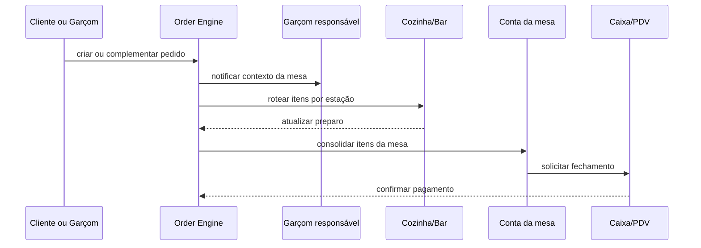

# Fluxo de Pedido e Plano de Desenvolvimento

## Estado atual

Este diagrama representa o fluxo-alvo do Restaurante; ele não significa que
todas as etapas já estejam implementadas. RESTAURANT-001 a RESTAURANT-005
entregaram partes da operação de mesas, setores, equipe, disponibilidade do
menu e QR Code. RESTAURANT-006 está em revisão e entrega a consulta pública do
cardápio por QR Code.

Na RESTAURANT-006, o cardápio é somente leitura: o cliente consulta os itens,
mas ainda não envia pedidos nem fecha a conta. Pedido, cozinha/KDS, delivery,
caixa e emissão fiscal dependem das tasks seguintes.

## Plano funcional do MVP Restaurante

A sequência abaixo segue o Master Backlog. Cada item permanece uma task
independente; esta documentação registra requisitos futuros, não antecipa sua
implementação nem altera sua ordem.

| Task | Entrega planejada |
| --- | --- |
| RESTAURANT-006 — Cardápio Online | Publicar a consulta responsiva do menu pelo QR da mesa. Sem criação de pedido, checkout ou pagamento. |
| RESTAURANT-007 — Pedidos, Garçom Responsável e Roteamento para Cozinha | Receber pedidos do cliente pelo QR ou registrados pelo garçom no mesmo fluxo; permitir pré-cadastro opcional do cliente com nome e telefone e CPF opcional; registrar quem lançou e o garçom responsável; associar pedidos de mesa à mesa; encaminhar itens às estações configuradas. |
| RESTAURANT-008 — KDS e Impressão | Apresentar a fila de produção por estação; permitir indicar o início e a conclusão do preparo; informar ao cliente e ao garçom se o pedido começou e estimar espera/preparo com base na fila e nos tempos observados; alertar a equipe sobre pedidos antigos ainda não iniciados; avisar o garçom quando o pedido estiver pronto. |
| RESTAURANT-009 — Delivery | Implementar o fluxo próprio de pedidos para entrega externa, mantendo-o distinto de pedidos de mesa e de retirada. |
| RESTAURANT-010 — Caixa | Consolidar o consumo, permitir a solicitação de fechamento da conta e registrar o pagamento pelo fluxo operacional de caixa/PDV. O gestor poderá habilitar ou desabilitar a capacidade de PDV por filial. |
| RESTAURANT-011 — Cupom ou NFC-e | Integrar a opção fiscal sem tornar a emissão fiscal requisito para concluir a venda. |

### Pedidos sem mesa

São dois contextos diferentes, ambos previstos para serem limitados a bebidas:

1. **Cliente aguardando mesa:** pedido de bebidas associado à espera, sem
   atribuição de uma mesa ainda ocupada.
2. **Retirada sem mesa:** pedido de bebidas para retirada, sem entrar na fila
   de espera por mesa.

Os dois cenários pertencem ao fluxo de pedidos da RESTAURANT-007. O segundo
não substitui Delivery: retirada e entrega externa têm modalidades distintas.

### PDV desabilitado

Se o gestor desabilitar o PDV da filial na RESTAURANT-010, o pagamento deverá
ocorrer fora do ERP. Ainda deverá existir um fluxo simplificado para registrar
que a conta foi paga externamente, preservando o estado da conta e a auditoria.
As permissões, os dados mínimos do registro e os controles contra fechamento
indevido devem ser definidos e testados na própria task de Caixa; esta decisão
não habilita captura de pagamento dentro do app do garçom.

### Evoluções posteriores

- Pagamento iniciado ou capturado diretamente pelo app do garçom e QR de
  validação na saída ficam para V2.
- Um dashboard gerencial responsivo com produção por setor, áreas críticas de
  demora, tempos de atendimento e reposição de produtos foi solicitado, mas
  ainda precisa ser posicionado em uma task própria do backlog antes de ser
  implementado. Não faz parte da RESTAURANT-006 nem altera a sequência atual.
- A experiência do garçom continuará sendo uma superfície dedicada da mesma
  base Flutter e backend, não um aplicativo ou serviço paralelo.

## Regras congeladas

1. Um pedido pode nascer do garçom, do cliente por QR, de balcão ou de delivery, mas usa o mesmo núcleo e eventos.
2. Pedido de mesa sempre carrega a mesa, o canal e, quando definido, o responsável da mesa.
3. O roteamento para cozinha/bar será por estação configurada e categoria/produto, nunca por lógica fixa na interface.
4. Impressão e KDS serão consumidores do mesmo evento de pedido; não haverá dois fluxos de preparo.
5. A baixa automática de insumos só será definida com Recipe Engine e Restaurant Production.
6. Conta, pagamento, cupom e fiscal permanecem etapas posteriores e não são antecipados pelo cadastro de mesas.
